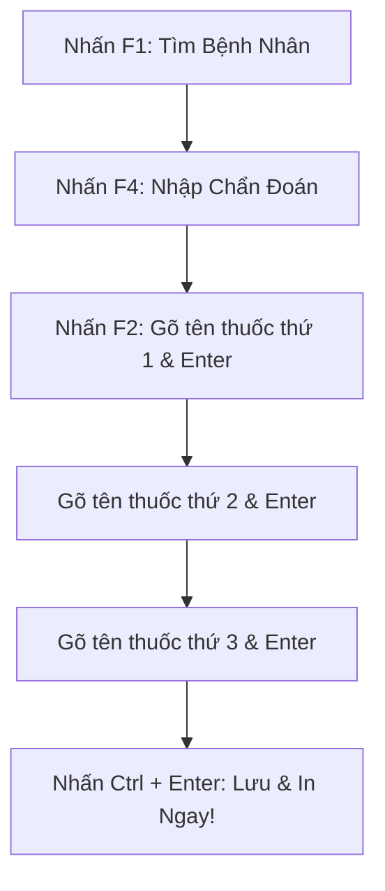

# 🏥 TÀI LIỆU HƯỚNG DẪN SỬ DỤNG HỆ THỐNG PHÒNG KHÁM BÁC SĨ TRẦN VĂN DIỆU
> **Phần mềm Quản lý Khám bệnh, Kê đơn & Tạo Lịch Nhắc Uống Thuốc Ngoại Trú**  
> *Phiên bản: 2.5 - Chế độ thao tác bàn phím siêu tốc (Zero-Mouse Clinical Workflow)*  
> *Bác sĩ phụ trách: BS. Trần Văn Diệu · Giấy phép HĐ / CCHN: 012345/HCM-CCHN*

---

## 📌 MỤC LỤC
1. [Giới Thiệu & Triết Lý Vận Hành "Zero-Mouse"](#1-giới-thiệu--triết-lý-vận-hành-zero-mouse)
2. [Bảng Tổng Hợp Phím Tắt Thao Tác Nhanh (Cheat Sheet)](#2-bảng-tổng-hợp-phím-tắt-thao-tác-nhanh-cheat-sheet)
3. [Quy Trình Khám Bệnh & Kê Đơn 30 Giây Siêu Tốc](#3-quy-trình-khám-bệnh--kê-đơn-30-giây-siêu-tốc)
4. [Quản Lý Hồ Sơ Bệnh Nhân & Tiền Sử Dị Ứng](#4-quản-lý-hồ-sơ-bệnh-nhân--tiền-sử-dị-ứng)
5. [Kho Thuốc Phòng Khám & Ma Trận Lịch Uống (Sáng - Trưa - Chiều - Tối)](#5-kho-thuốc-phòng-khám--ma-trận-lịch-uống)
6. [In Toa Thuốc & Bảng Nhắc Lịch Uống (Khổ A4 / A5)](#6-in-toa-thuốc--bảng-nhắc-lịch-uống)
7. [Trợ Lý Lâm Sàng Gemini AI Hỗ Trợ Kê Đơn](#7-trợ-lý-lâm-sàng-gemini-ai-hỗ-trợ-kê-đơn)
8. [Sao Lưu Dữ Liệu & Bảo Mật Phòng Khám](#8-sao-lưu-dữ-liệu--bảo-mật-phòng-khám)
9. [Xử Lý Sự Cố & Câu Hỏi Thường Gặp (FAQ)](#9-xử-lý-sự-cố--câu-hỏi-thường-gặp-faq)

---

## 1. Giới Thiệu & Triết Lý Vận Hành "Zero-Mouse"

Trong thực tế thăm khám tại phòng khám tư và phòng khám chuyên khoa, mỗi ngày Bác sĩ phải tiếp nhận hàng chục bệnh nhân. Việc liên tục phải **rời tay khỏi bàn phím để cầm chuột** rê đến từng ô nhập liệu (tìm bệnh nhân, nhập huyết áp, gõ chẩn đoán, click từng viên thuốc) làm gián đoạn dòng suy nghĩ lâm sàng và gây mỏi khớp cổ tay.

### 🎯 Mục tiêu của chế độ "Zero-Mouse":
* **Không cần đụng chuột:** Bác sĩ có thể thao tác hoàn chỉnh từ bước tiếp nhận bệnh nhân, ghi nhận sinh hiệu, tìm và thêm nhiều thuốc đến khi in toa chỉ bằng bàn phím.
* **Tốc độ tối đa:** Kê một toa thuốc mạn tính gồm 3-4 thuốc chỉ mất **chưa đầy 30 giây**.
* **Trực quan & Dễ nhớ:** Bố trí các phím chức năng F1 - F12 quen thuộc trong ngành y tế kết hợp phím bổ trợ Alt/Ctrl tiêu chuẩn.
* **Bảo vệ an toàn người bệnh:** Hệ thống tự động cảnh báo dị ứng thuốc và kiểm tra tương tác thuốc trước khi in.

---

## 2. Bảng Tổng Hợp Phím Tắt Thao Tác Nhanh (Cheat Sheet)

Bác sĩ có thể bấm phím <kbd>?</kbd> (hoặc <kbd>F12</kbd>) bất kỳ lúc nào trên màn hình để mở nhanh cửa sổ tra cứu phím tắt.

### 💊 Kê Đơn & Chọn Thuốc Thần Tốc (Không Cần Chuột)
| Phím tắt | Thao tác | Mô tả chi tiết |
| :--- | :--- | :--- |
| **`F2`** hoặc **`/`** | **Nhảy nhanh vào ô Tìm Thuốc** | Tự động chuyển về giao diện kê đơn, focus ô tìm kiếm trong kho dược và bôi đen từ khóa cũ. |
| **`↓` (Mũi tên xuống)** | **Chọn thuốc kế tiếp** | Di chuyển vệt sáng lựa chọn xuống thuốc bên dưới trong danh sách kết quả. |
| **`↑` (Mũi tên lên)** | **Chọn thuốc phía trước** | Di chuyển vệt sáng lựa chọn lên thuốc phía trên. |
| **`Enter`** | **Thêm thuốc vào toa ngay** | Đưa thuốc đang được chọn vào đơn với liều dùng chuẩn mặc định. Ô tìm kiếm tự động làm sạch để Bác sĩ gõ ngay thuốc tiếp theo! |
| **`Alt + T`** | **Thêm dòng Thuốc Tự Do** | Mở thêm một dòng thuốc mới để tự gõ tên biệt dược và liều lượng ngoài danh mục. |
| **`Esc`** | **Xóa tìm kiếm / Thoát** | Xóa nhanh từ khóa trong ô tìm thuốc hoặc bỏ focus. |

### 🩺 Khám Bệnh & Quản Lý Bệnh Nhân
| Phím tắt | Thao tác | Mô tả chi tiết |
| :--- | :--- | :--- |
| **`F1`** hoặc **`Alt + B`** | **Tìm & Chọn Bệnh Nhân** | Nhảy con trỏ vào ô tìm bệnh nhân theo Tên, Số điện thoại hoặc Mã BN. |
| **`F3`** hoặc **`Alt + N`** | **Tiếp Nhận Bệnh Nhân Mới** | Mở pop-up thêm hồ sơ bệnh nhân mới. Nhấn `Ctrl + Enter` để lưu nhanh. |
| **`F4`** hoặc **`Alt + D`** | **Nhập Chẩn Đoán Bệnh** | Nhảy thẳng con trỏ vào ô nhập Chẩn đoán lâm sàng của Bác Sĩ Diệu & ICD-10. |

### 💾 Lưu Trữ, Xem Trước & In Ấn
| Phím tắt | Thao tác | Mô tả chi tiết |
| :--- | :--- | :--- |
| **`Ctrl + S`** | **Lưu Đơn Thuốc** | Lưu đơn thuốc vào hồ sơ phòng khám (chặn hành vi lưu trang web của trình duyệt). |
| **`Ctrl + Enter`** hoặc **`F9`** | **LƯU & IN TOA NGAY** | **Quy trình 1-chạm:** Vừa lưu vào hồ sơ vừa chuyển sang bản in có đầy đủ lịch nhắc uống thuốc! |
| **`F8`** hoặc **`Alt + R`** | **Xem Trước / Review Toa** | Mở modal xem trước bản in toa thuốc và ma trận lịch uống sáng/trưa/chiều/tối. |

### 🧭 Điều Hướng Nhanh Giữa Các Tab
| Phím tắt | Màn hình đích | Mô tả |
| :--- | :--- | :--- |
| **`Alt + 1`** | **Khám Bệnh & Kê Toa** | Màn hình làm việc chính của Bác sĩ. |
| **`Alt + 2`** | **Danh Sách Bệnh Nhân** | Tra cứu hồ sơ, lịch sử khám và thông tin liên lạc. |
| **`Alt + 3`** | **Hồ Sơ Toa Thuốc** | Xem lại toàn bộ đơn thuốc đã kê, in lại toa cũ hoặc xóa đơn nhầm. |
| **`Alt + 4`** | **In Toa & Lịch Uống** | Màn hình in ấn trực tiếp khổ giấy A4/A5. |

### 🤖 Tiện Ích, Kho Dược & AI
| Phím tắt | Thao tác | Mô tả |
| :--- | :--- | :--- |
| **`F6`** hoặc **`Alt + K`** | **Mở Kho Thuốc Phòng Khám** | Xem và quản lý 44+ danh mục biệt dược, hoạt chất và hàm lượng. |
| **`F7`** hoặc **`Alt + J`** | **Trợ Lý Gemini AI** | Kích hoạt AI phân tích tương tác thuốc, liều lượng và bệnh học. |
| **`F10`** hoặc **`Alt + G`** | **Tài Liệu Hướng Dẫn Này** | Mở tài liệu hướng dẫn sử dụng ngay trên màn hình. |
| **`?`** hoặc **`F12`** | **Bảng Tra Cứu Phím Tắt** | Mở pop-up phím tắt nhanh. |
| **`Esc`** | **Đóng Hộp Thoại (Modal)** | Đóng bất kỳ cửa sổ nào đang hiển thị trên màn hình. |

---

## 3. Quy Trình Kê Đơn 30 Giây Siêu Tốc

Dưới đây là kịch bản mẫu: Bác sĩ Diệu khám và kê đơn cho bệnh nhân **Nguyễn Văn An (65 tuổi)** mắc bệnh **Tăng huyết áp nguyên phát** và **Đái tháo đường Type 2**:

### Chi tiết thao tác từng giây:
1. **Giây 0 - 5: Chọn bệnh nhân**
   * Nhấn <kbd>F1</kbd> → Gõ `An` hoặc `0912` → Bệnh nhân Nguyễn Văn An được hiển thị.
2. **Giây 6 - 10: Chẩn đoán**
   * Nhấn <kbd>F4</kbd> → Gõ `Tăng huyết áp - ĐTĐ type 2` (hoặc click nút gợi ý `+ Tăng huyết áp nguyên phát`).
3. **Giây 11 - 25: Kê đơn bằng phím F2**
   * Nhấn <kbd>F2</kbd> → Gõ `Amlo` → Thuốc *Amlodipin 5mg* xuất hiện đầu danh sách → Nhấn <kbd>Enter</kbd> (Thuốc 1 đã vào toa).
   * Ô tìm kiếm tự động xóa sạch, gõ tiếp `Glucophage` (hoặc `Metfor`) → Nhấn <kbd>Enter</kbd> (Thuốc 2 đã vào toa).
   * Gõ tiếp `Panto` → Nhấn <kbd>Enter</kbd> (*Pantoprazol 40mg* đã vào toa).
4. **Giây 26 - 30: Chốt đơn và in ấn**
   * Nhấn tổ hợp <kbd>Ctrl + Enter</kbd> → Toàn bộ đơn thuốc được lưu trữ vào cơ sở dữ liệu phòng khám và hệ thống tự động chuyển ngay sang trang in kèm Lịch nhắc uống thuốc rõ ràng cho bệnh nhân!

---

## 4. Quản Lý Hồ Sơ Bệnh Nhân & Tiền Sử Dị Ứng

### 4.1. Thêm bệnh nhân mới (<kbd>F3</kbd>)
* Nhấn <kbd>F3</kbd> để mở cửa sổ tiếp nhận.
* Nhập **Họ và tên**, **Năm sinh**, **Giới tính**, **Số điện thoại**, **Địa chỉ**, **Số thẻ BHYT**.
* Bấm <kbd>Ctrl + Enter</kbd> để lưu ngay hồ sơ. Hệ thống sẽ tự động tạo mã bệnh nhân chuẩn dạng `BN-0001`, `BN-0002`...

### 4.2. Cảnh báo an toàn dị ứng thuốc
* Khi bệnh nhân có tiền sử dị ứng (ví dụ: `Dị ứng Penicillin`, `Dị ứng Aspirin`), hệ thống sẽ hiển thị một **khung đỏ cảnh báo nổi bật kèm icon bảo vệ** trên màn hình kê đơn.
* Bác sĩ cần lưu ý kiểm tra không kê các hoạt chất cùng nhóm hoặc có phản ứng chéo.

---

## 5. Kho Thuốc Phòng Khám & Ma Trận Lịch Uống

Hệ thống được thiết kế với danh mục hơn **44 biệt dược thiết yếu** thường dùng tại phòng khám nội khoa và đa khoa:
* **Nhóm Tim Mạch - Huyết Áp:** Amlodipin 5mg, Losartan 50mg, Telmisartan 40mg, Concor 2.5mg, Micardis Plus...
* **Nhóm Đái Tháo Đường:** Metformin 500mg/850mg, Diamicron MR 60mg, Januvia 100mg, Jardiance 10mg...
* **Nhóm Tiêu Hóa - Dạ Dày:** Nexium 40mg, Pantoprazol 40mg, Phosphalugel, Motilium-M...
* **Nhóm Kháng Sinh - Hô Hấp:** Augmentin 1g, Klamentin, Cefuroxim 500mg, Azithromycin 500mg...
* **Nhóm Cơ Xương Khớp & Thần Kinh:** Celebrex 200mg, Meloxicam 7.5mg, Betaserc 16mg, Tanakan...

### ⏰ Ma trận lịch uống và tự động tính số lượng:
Mỗi loại thuốc được cấu hình sẵn 4 khung giờ trong ngày:
* 🌅 **Sáng (Morning):** Sau ăn sáng hoặc trước ăn sáng (thuốc dạ dày).
* ☀️ **Trưa (Noon):** Sau ăn trưa.
* 🌇 **Chiều (Afternoon):** Khoảng 16h - 17h.
* 🌙 **Tối (Evening):** Trước khi đi ngủ hoặc sau ăn tối.

> **Công thức tính tổng lượng thuốc:**  
> $$\text{Tổng viên} = (\text{Sáng} + \text{Trưa} + \text{Chiều} + \text{Tối}) \times \text{Số ngày điều trị}$$
> *Bác sĩ chỉ cần đổi số viên hoặc số ngày (mặc định 7 ngày hoặc 30 ngày), tổng số viên cấp sẽ tự động cập nhật ngay tức thì.*

---

## 6. In Toa Thuốc & Bảng Nhắc Lịch Uống

Bản in được thiết kế chuẩn mực theo quy định của Bộ Y Tế, khổ giấy linh hoạt **A4** hoặc **A5**, bao gồm 3 chế độ:

1. **In Đầy Đủ (Toa Thuốc + Bảng Nhắc Lịch Uống):** *(Khuyên dùng)*
   * Nửa trên là Đơn thuốc ngoại trú chuẩn mực y khoa (Thông tin phòng khám, CCHN bác sĩ, chẩn đoán ICD-10, chữ ký Bác sĩ Diệu).
   * Nửa dưới là **Bảng chia liều uống thuốc theo biểu tượng trực quan** (Sáng ☀️, Trưa 🌤️, Chiều 🌇, Tối 🌙) giúp bệnh nhân cao tuổi và người nhà không bao giờ bị uống nhầm liều.
2. **Chỉ In Toa Thuốc:** Tiết kiệm giấy, in đơn thuốc ngoại trú tiêu chuẩn.
3. **Chỉ In Bảng Nhắc Lịch Uống:** Bảng hướng dẫn dán lên tủ lạnh cho bệnh nhân theo dõi.

### 💡 Mẹo in đẹp trên Google Chrome / Microsoft Edge:
* Trong cửa sổ in (Print Preview):
  * Mục **Margins (Lề):** Chọn `Minimum` hoặc `Custom`.
  * Mục **Options:** Bỏ tích chọn ô `Headers and footers` (để không in đường link website hoặc ngày tháng của trình duyệt lên đầu trang).
  * Mục **Color:** Chọn `Color` để các icon buổi sáng/trưa/chiều/tối hiển thị sinh động.

---

## 7. Trợ Lý Lâm Sàng Gemini AI Thế Hệ 3.5+ Hỗ Trợ Kê Đơn

Nhấn <kbd>F7</kbd> (hoặc nút **Trợ Lý Gemini AI** ở thanh điều hướng) để mở trợ lý trí tuệ nhân tạo chuyên sâu:
* **Chuỗi Model AI Ưu Tiên (Auto-Fallback Chain):** `gemini-3.5-flash` (mặc định chính) $\rightarrow$ `gemini-3.8-flash` $\rightarrow$ `gemini-3.5-flash-lite` $\rightarrow$ `gemini-2.5-flash` $\rightarrow$ `Offline Clinical Rules Engine (0ms)`. Nếu bất kỳ model nào chạm quota hoặc giới hạn gói cước, hệ thống tự động nhảy sang model kế tiếp trong chuỗi mà không làm gián đoạn thao tác của Bác sĩ.
* **Dropdown chọn Model AI:** Bác sĩ có thể chủ động chọn model mong muốn ngay trên thanh Header hoặc trong khung Trợ lý AI, đồng thời theo dõi tên model thực tế vừa phản hồi kèm thời gian xử lý (ms).
* **Kiểm tra tương tác thuốc:** AI sẽ tự động đọc danh sách các thuốc đang có trong toa, kiểm tra xem có tương tác nguy hiểm (ví dụ: phối hợp thuốc gây suy thận, hạ huyết áp quá mức, hoặc kéo dài khoảng QT).
* **Kiểm tra chống chỉ định với tiền sử bệnh nhân:** Ví dụ Bệnh nhân bị Loét dạ dày nhưng bác sĩ đang dự định kê NSAIDs liều cao, AI sẽ đề xuất phối hợp thêm PPI hoặc đổi hoạt chất an toàn hơn.
* **Gợi ý lời dặn dò:** Tự động soạn sẵn các lưu ý chế độ ăn (hạn chế muối, kiêng bia rượu, theo dõi huyết áp nhật ký tại nhà).

---

## 7.1. Bộ Lọc Chống Trùng Thuốc Chuẩn Y Khoa & Gói 150+ Thuốc Thiết Yếu
* **🧹 Nút Quét & Lọc Trùng Kho Thuốc:** Ngay trên tiêu đề Kho Thuốc, một cú nhấp chuột sẽ kích hoạt thuật toán chuẩn hóa `getDrugCanonicalKey` (chuẩn hóa tên, bỏ dấu, đồng nhất đơn vị g $\rightarrow$ mg, mcg $\rightarrow$ mg) để rà soát toàn bộ kho thuốc, tự động gộp các thuốc trùng lặp và đồng bộ ngay lên Supabase + Local Cache.
* **⚡ Nút Nạp Nhanh Bộ 150+ Thuốc Thiết Yếu:** Nạp sẵn danh mục hơn 150 biệt dược phổ biến nhất theo chuẩn 11 chuyên khoa nội khoa Việt Nam (Dược thư Quốc gia), tự động lọc bỏ các thuốc đã có trong kho và bổ sung đầy đủ liều dùng Sáng-Trưa-Chiều-Tối, cách uống và cảnh báo lâm sàng.
* **🤖 Bot Cào Thuốc Mới Thông Minh:** Cơ chế loại trừ thông minh (Exclusion Prompting) gửi danh sách toàn bộ thuốc đã có vào prompt AI để chỉ cào các thuốc mới hoàn toàn theo 11 nhóm bệnh lý hoặc từ khóa hoạt chất do Bác sĩ chỉ định.

---

## 8. Sao Lưu Dữ Liệu & Bảo Mật Phòng Khám

* **Lưu trữ tức thì (Auto-Save):** Toàn bộ dữ liệu bệnh nhân, đơn thuốc và danh mục kho dược được lưu trữ an toàn trong LocalStorage của trình duyệt. Dù mất điện đột ngột hay tắt trình duyệt, dữ liệu vẫn giữ nguyên 100%.
* **Xuất file sao lưu (JSON Backup):**
  * Nhấp nút **"Sao lưu (JSON)"** ở chân trang để tải file dữ liệu dự phòng về máy tính (ví dụ: `DuLieuPhongKham_BS_TranVanDieu_2026-11-01.json`).
  * Khuyến cáo Bác sĩ nên lưu file này vào USB hoặc Google Drive vào cuối mỗi tuần làm việc.
* **Khôi phục dữ liệu:** Có thể nạp lại dữ liệu dễ dàng khi Bác sĩ đổi máy tính mới hoặc cài lại máy.

---

## 9. Xử Lý Sự Cố & Câu Hỏi Thường Gặp (FAQ)

### Q1: Nhấn phím F1 trên trình duyệt Chrome lại mở trang trợ giúp của Google?
* **Trả lời:** Hệ thống đã được lập trình để chặn hành vi mặc định của phím F1. Tuy nhiên nếu Bác sĩ đang click chuột ra ngoài vùng cửa sổ trang web, hãy click nhẹ vào màn hình phần mềm một lần rồi nhấn lại F1, hoặc sử dụng tổ hợp thay thế **`Alt + B`**.

### Q2: Tôi muốn kê thuốc chưa có trong kho 44 thuốc có sẵn thì làm sao?
* **Trả lời:** Bác sĩ có thể dùng 1 trong 2 cách:
  * **Cách 1 (Nhanh nhất):** Nhấn **`Alt + T`** để thêm ngay 1 dòng thuốc tự do, sau đó gõ tên thuốc và số viên tùy ý.
  * **Cách 2 (Lưu vĩnh viễn):** Nhấn **`F6`** mở Kho Thuốc, bấm nút "+ Thêm Thuốc Mới Vào Kho" để lưu vào danh mục dùng cho các lần sau.

### Q3: Muốn đổi thông tin tên phòng khám, địa chỉ và số điện thoại trên tiêu đề toa thuốc?
* **Trả lời:** Bấm vào biểu tượng **Bánh răng (Cài đặt)** ở góc trên bên phải thanh điều hướng. Nhập tên phòng khám mới, số CCHN, địa chỉ và hotline rồi nhấn Lưu. Mọi toa thuốc in ra sau đó sẽ tự động mang thông tin mới.

### Q4: Máy in bị nhảy sang trang thứ 2 khi in toa thuốc?
* **Trả lời:** Do lề giấy của máy in đang để quá rộng. Trong hộp thoại in của trình duyệt, chọn mục **More settings** → chỉnh **Scale (Tỷ lệ)** thành `90%` hoặc `Fit to printable area` để toàn bộ đơn thuốc và bảng nhắc liều nằm gọn đẹp trong 1 trang duy nhất.

---

*Tài liệu được biên soạn và tối ưu cho Phòng khám Bác Sĩ Trần Văn Diệu.*  
*Chúc Bác Sĩ có những giờ làm việc nhẹ nhàng, nhanh chóng và chính xác!*
